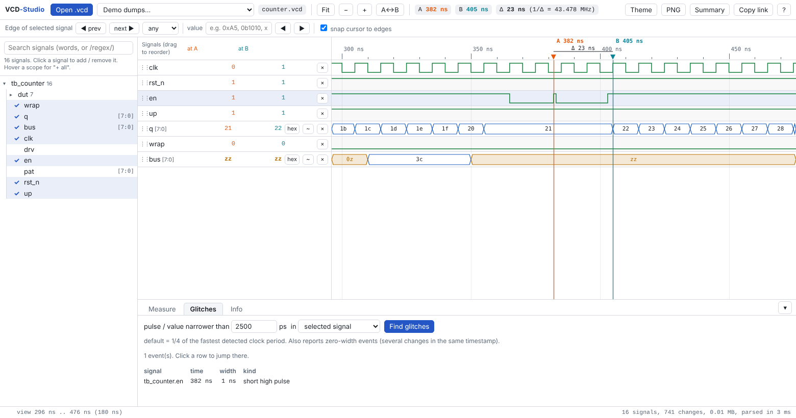
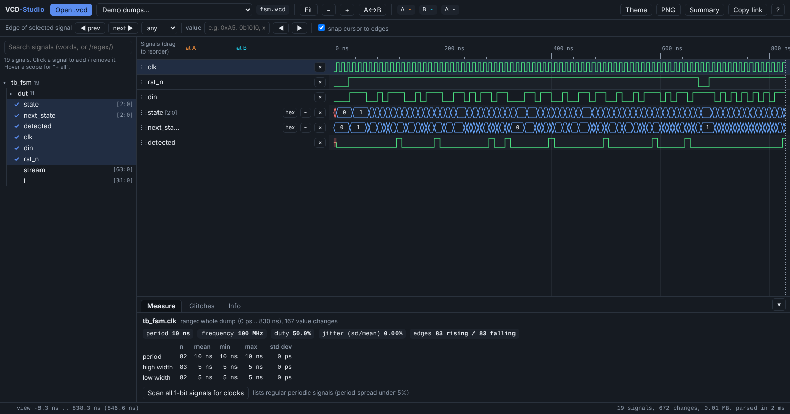
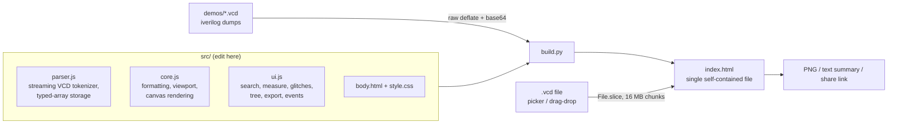

# VCD-Studio

[](https://github.com/Kavin-Re/VCD-Studio/actions/workflows/ci.yml)


**A waveform viewer for Verilog `.vcd` dumps that is a single HTML file.**
Open `index.html` in a browser, drop a dump on it, and you get a signal tree, zoom/pan, two cursors, edge and value
search, clock measurements, a glitch finder and PNG/text export. Nothing is installed, nothing is uploaded: the
file is parsed locally in the page and the page makes no network requests.

A companion script, `vcd_stats.py`, reports per-signal toggle counts and a switching-activity proxy from the
command line (Python standard library only).



<details><summary>Dark theme</summary>



</details>

## Try it

- **Locally:** download [`index.html`](index.html) and double-click it. That is the whole application (about 109 kB,
  three small demo dumps included). It works from `file://`.
- **Hosted:** the repo is ready for GitHub Pages (see [Deploying](#deploying-to-github-pages)); once enabled the viewer
  is served at `https://kavin-re.github.io/VCD-Studio/`.

Then use **Open .vcd**, drag a file onto the window, or pick one of the built-in demos.

## Features

| Area | What it does |
|---|---|
| Parsing | Byte-level streaming parser, fed in 16 MB slices so the UI stays responsive; values stored in typed arrays. Scalars, vectors of any width, `real` variables, `x`/`z` (also `u w l h -`), nested scopes, aliased identifier codes (one net, several names). |
| Navigation | Zoom (keys, Ctrl+wheel at pointer, drag in the ruler), pan (drag, Shift+wheel, arrows), fit, zoom-to-cursors. Dense regions are drawn as one column per pixel, so a full view of millions of changes stays cheap. |
| Signals | Hierarchical tree with lazy expansion, word or `/regex/` search, "+ all" per scope, drag-to-reorder rows. |
| Values | Radix per bus: hex, binary, unsigned, signed (BigInt above 32 bits). `x` is drawn red, `z` amber; partially unknown hex digits show as `X`/`Z`. Analog (step) view for buses and reals. |
| Cursors | A (click) and B (Shift+click) with edge snapping, value columns at both cursors, delta and 1/delta. |
| Search | Next/previous edge (any, rising, falling) and next/previous value match (`0x1F`, `0b1010`, `'d42`, `x`, `z`). |
| Measure | Period, frequency, duty cycle, high/low widths and spread for the selected 1-bit signal, over the whole dump or between the cursors; a scan that lists clock-like signals. |
| Glitches | Lists pulses or values shorter than a threshold (default: a quarter of the fastest detected clock period) and zero-width events (several changes of one signal at the same timestamp). |
| Export | PNG of the current view (2x), a plain-text summary, and a share link: the URL hash stores the selected signals, radix, cursors and view. |
| Comfort | Light/dark theme (follows the OS until you choose one), keyboard shortcuts for everything (press `?`). |

### Keyboard and mouse

| Key | Action | Key | Action |
|---|---|---|---|
| `O` | open file | `T` | light / dark |
| `F` | fit whole dump | `Z` | zoom to cursors A..B |
| `+` / `-` | zoom in / out | `←` `→` | pan (Shift = faster) |
| `Home` / `End` | start / end of dump | `/` | search signals |
| `N` / `P` | next / previous edge | `]` / `[` | next / previous value match |
| `R` | cycle radix | `G` | analog view for selected bus |
| `↑` `↓` | select row | `Alt`+`↑`/`↓` | move row |
| `Del` | remove row | `C` | clear cursors |
| `E` / `Shift`+`E` | export PNG / text summary | `L` | copy share link |

Mouse: click = cursor A, Shift+click = cursor B, drag = pan, Ctrl/Cmd+wheel = zoom at pointer, Shift+wheel = pan,
drag in the ruler = zoom to that range.

## How it is put together



- `src/parser.js` works on bytes, not strings. Each identifier code maps to one record holding a `Float64Array` of
  times and `Uint32Array`s for value, unknown-mask and z-mask (32 bits per word, so any vector width works). Redundant
  changes (same value again) are dropped; a token split across two chunks is carried over to the next one.
- `src/core.js` draws on a `<canvas>`. For every row it builds runs: where more than one change falls into the same
  pixel column, the whole column is drawn as one "dense" bar, using prefix sums to know whether any `x`/`z` is inside.
- `src/ui.js` holds the tools. All file-derived text (scope, signal and file names, `$date`, `$version`,
  `$comment`) is HTML-escaped or set through `textContent` before it reaches the DOM.
- `build.py` concatenates the sources and embeds the demos. `index.html` is committed so the app can be used
  without building; `python3 build.py --check` (run in CI) fails if it is out of date.

```
index.html          the application (generated by build.py, committed)
src/                parser.js, core.js, ui.js, body.html, style.css
demos/              counter.vcd, fsm.vcd, hop_engine.vcd (embedded into index.html)
sim/                Verilog sources + testbenches that produced the demos (iverilog)
vcd_stats.py        command-line toggle / activity statistics
tests/              unit tests (Node, Python) and browser tests
docs/               README screenshots (regenerate: node tests/browser_smoke.mjs --screenshot docs/screenshot.png)
```

## `vcd_stats.py`

```console
$ python3 vcd_stats.py demos/counter.vcd --top 4
timescale 1ps   span 0..1783000   sim time 1.783e-06 s
clock     tb_counter.clk   period 1e-08 s (100 MHz)   rising edges 178

signal               width   changes   toggles     xz  activity
tb_counter.clk           1       356       356      0    2.0000
tb_counter.dut.clk       1       356       356      0    2.0000  (alias)
tb_counter.dut.q         8       171       339      1    0.2381
tb_counter.q             8       171       339      1    0.2381
...
```

Options: `--scope PREFIX`, `--clock NAME`, `--sort {toggles,changes,activity,xz_events}`, `--json`, and
`--cap-ff C --vdd V` for a `0.5·C·V²·toggles / time` figure. That last number uses one capacitance you assume for
every bit and ignores glitch, short-circuit, leakage, clock-tree and wire power. It is useful for comparing two runs
of the same design and is **not** a power estimate. The script's docstring defines every column.

It is also an independent second implementation of the VCD format: the browser test suite checks that the viewer's
parser and `vcd_stats.py` agree on width, change count and bit-toggle count for every signal of every demo.

## Development

```bash
python3 build.py                                   # rebuild index.html after editing src/ or demos/
python3 build.py --check                           # is index.html up to date?

node --test tests/parser.test.mjs                  # parser + value formatting (Node >= 22, no packages)
python3 -m unittest discover -s tests -p "test_vcd_stats.py"   # vcd_stats.py (stdlib only)
node tests/browser_smoke.mjs                       # headless Chrome: start-up, demos, hostile-name (XSS) check

pip install playwright && playwright install chromium
python3 tests/gen_big_vcd.py out/big.vcd           # 30 MB, about 1.9 M value changes
python3 tests/test_viewer.py --big                 # full end-to-end suite (40+ checks), screenshots in out/
```

The demos are regenerated with `sim/run_sims.sh` (needs Icarus Verilog). The third demo is a dump of the keyed
hop engine from the separate [FHSS-Link](https://github.com/Kavin-Re/FHSS-Link) project; by default the script looks for
a sibling checkout (`../FHSS-Link/rtl/hop_engine`); set `HOP_DIR` to use another location. Without it the hop demo is
skipped and the committed dump is kept.

### What the tests cover

| Suite | Runs where | Checks |
|---|---|---|
| `tests/parser.test.mjs` | Node | 12 tests: scopes, aliases, x/z extension, reals, wide vectors, signed decimal, timescale forms, `$dumpoff`, CRLF, garbage input, identifier codes that look like syntax (`#`, `$`, `b`), and chunked feeding at every split point giving the same result as one buffer |
| `tests/test_vcd_stats.py` | Python | 11 tests of the statistics script |
| `tests/browser_smoke.mjs` | headless Chrome via DevTools protocol | start-up without console errors or network requests, the three demos, and a VCD whose scope / signal / file names and `$date` / `$comment` contain HTML and event-handler payloads: nothing may execute or become an element |
| `tests/test_viewer.py` | Playwright | 40+ UI checks: zoom, cursors, search, radix, analog, measure, glitch finder, exports, share link, drag-and-drop, large file |

## Performance

Measured for this README with `tests/gen_big_vcd.py` (30.4 MB, 1,871,277 stored value changes): the parser alone,
run under Node 22 in a Linux container, takes about 0.9 s (roughly 34 MB/s). That is one machine and excludes file
reading and drawing in a browser; `tests/test_viewer.py --big` measures load and redraw time in Chromium and CI
uploads its output. No browser-side timing is quoted here because it was not re-measured for this document.

## Limitations

- VCD only: no FST, GHW, LXT or extended-VCD (`$dumpports`) support.
- The whole dump is held in memory (roughly 12 to 20 bytes per value change for a signal up to 32 bits wide; more
  for wide vectors or signals that carry `x`/`z`). There is no on-disk index, so multi-gigabyte dumps are out of scope.
- String variables (`s...` value changes) are skipped. Strength values (`l h u w -`) are mapped to 0, 1 or x.
- Timestamps are JavaScript doubles: exact up to 2^53 time units. Timestamps are expected to be non-decreasing, as
  the format requires.
- When two signals have the same hierarchical path, share links and demo defaults resolve to the first one.
- The built-in demos are inflated with `DecompressionStream`, so they need a 2023-or-newer browser; opening your
  own files does not.
- There are no signal groups, dividers, colours per signal, or saved sessions beyond the share link.
- The glitch finder is a width filter on recorded value changes. It knows nothing about setup/hold or about what
  the simulator did not dump.

## Deploying to GitHub Pages

The app is a static file, so either option works:

1. **Workflow (included):** Settings → Pages → Source: **GitHub Actions**. `.github/workflows/pages.yml` then
   publishes `index.html` on every push to `main` that touches it, after checking it is not stale.
2. **No workflow:** Settings → Pages → Source: **Deploy from a branch**, `main`, `/ (root)`.

## Roadmap

- FST reading (would need a WebAssembly decoder; breaks the "no dependencies" property unless inlined).
- Parsing in a Web Worker so that very large files do not block input at all.
- Signal groups / dividers and a way to save them.
- Bus decoding helpers (enum names for FSM state vectors).

## License

No license file has been added yet, so default copyright applies. If you want others to reuse this, add one
(MIT is the usual choice for a tool like this).
